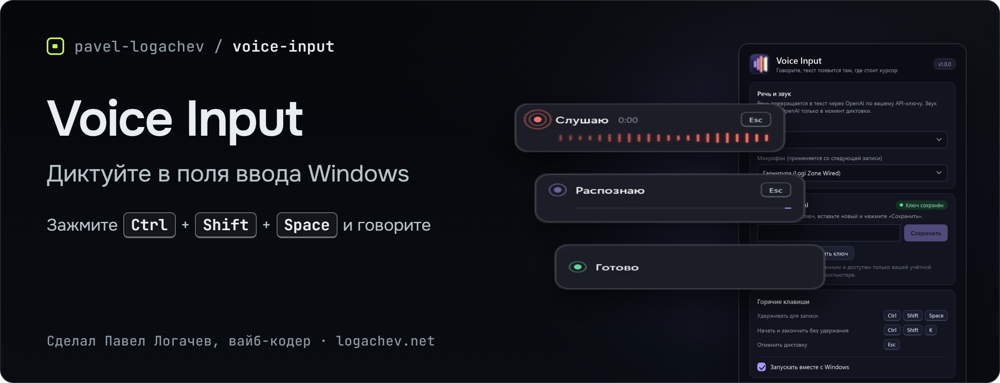

<picture><source media="(max-width: 767px)" srcset="docs/assets/voice-input-banner-mobile.png"></picture>

# Voice Input

Кейс на сайте: <https://logachev.net/#case-voice-input>

[](https://github.com/pavel-logachev/voice-input/releases/latest) [](https://github.com/pavel-logachev/voice-input/actions/workflows/ci.yml) [](<LICENSE>)

**Диктуйте в поля ввода Windows: зажмите `Ctrl + Shift + Space`, скажите фразу и отпустите клавиши — текст появится у курсора.**

[Скачать](https://github.com/pavel-logachev/voice-input/releases/latest) · [Как пользоваться](<#как-пользоваться>) · [Приватность](<#приватность>) · [Архитектура](<docs/ARCHITECTURE.md>)

Windows 10 1809+ / 11 x64

Voice Input работает в системном трее. Речь распознает движок, выбранный в настройках: OpenAI по вашему API-ключу (нужен интернет, запросы оплачиваются с вашего аккаунта OpenAI), модель GigaAM на этом компьютере без интернета или ваш сервер с API, совместимым с OpenAI.

Первый запуск — [установить приложение и выбрать движок в настройках](<#установка>).

## Как пользоваться

1. **Поставьте курсор** в нужное поле: в мессенджере, почте, браузере или редакторе кода.
2. **Зажмите `Ctrl + Shift + Space` и говорите.** Пока клавиши зажаты, идет запись.
3. **Отпустите клавиши.** Дождитесь распознавания — текст появится в поле у курсора.

Для записи без удержания используйте `Ctrl + Shift + K`: первое нажатие начинает запись, повторное — завершает.

Чтобы отменить запись или распознавание, нажмите `Esc`: текст не вставится, даже если ответ придет позже.


*Оверлей в шести состояниях и окно настроек Voice Input 1.2.*

## Что предусмотрено

- **Видно, что происходит.** Оверлей показывает этап диктовки, таймер и уровень голоса, не забирая фокус и не перехватывая клики мыши. У каждого этапа свой знак, а не только цвет. Поддерживается высокая контрастность.
- **Проверка окна перед вставкой.** Если активно другое окно, текст не вставляется.
- **Восстановление буфера обмена.** После вставки возвращается прежнее содержимое, если за это время оно не изменилось.
- **До 10 минут на запись.** На лимите запись останавливается, сказанное распознается и вставляется.
- **Обработка потери микрофона.** Если его отключили во время записи, приложение сообщает об ошибке и ничего не вставляет.
- **Понятные причины ошибок.** Неверный ключ, исчерпанный лимит или баланс OpenAI, отсутствие сети, недоступность сервиса.
- **Конфликт клавиш не мешает запуску.** Если одно сочетание занято другой программой, приложение сообщает об этом и работает со вторым.
- **Один экземпляр приложения.** Повторный запуск не создает вторую копию.

## Настройки

Откройте настройки двойным щелчком по значку Voice Input в трее.

- **Движок распознавания:** «OpenAI, через интернет», «На этом компьютере (GigaAM)» или «Свой сервер» — подробнее ниже.
- **API-ключ OpenAI:** добавьте или замените ключ кнопкой «Сохранить» или клавишей `Enter`. Доступны «Проверить» и «Удалить ключ»; после сохранения проверка запускается автоматически.
- **Язык речи:** «Определять автоматически», «Русский», «English», «Українська» или «Deutsch» — подсказка для облачного распознавания.
- **Микрофон:** конкретное устройство или «По умолчанию в Windows». Новый выбор применяется со следующей записи.
- **Автозапуск:** «Запускать вместе с Windows».

Окном можно управлять с клавиатуры: `Tab` переходит между полями, `Esc` закрывает окно.

**OpenAI, через интернет.** Звук отправляется в OpenAI. Нужен API-ключ OpenAI, запросы оплачиваются с вашего аккаунта OpenAI.

**На этом компьютере (GigaAM).** Модель GigaAM-v3 от Сбера (вариант E2E RNNT) распознает речь на процессоре, без интернета: звук не покидает компьютер, текст получается сразу с пунктуацией. Модель рассчитана на русскую речь. Ее нужно один раз загрузить кнопкой «Загрузить модель» — 184 МБ с Hugging Face. Во время загрузки видны прогресс и скорость. Загрузку можно поставить на паузу и продолжить с того же места, в том числе после обрыва связи или перезапуска приложения; она продолжается, даже если закрыть окно настроек. Перед загрузкой проверяется свободное место на диске, после — файл по SHA-256. Удалить модель можно кнопкой «Удалить модель», приложение попросит подтверждения. Если движок выбран, а модель не загружена, при диктовке приложение сообщит об этом и откроет настройки.

**Свой сервер.** Любой сервис с API распознавания, совместимым с OpenAI: Groq, LocalAI, faster-whisper-server или ваш собственный. Укажите адрес API с префиксом (например, `https://api.groq.com/openai/v1`), имя модели и, если сервер его требует, API-ключ. Адрес с `http` разрешен только для этого компьютера и локальной сети, для остальных адресов нужен `https`. Кнопка «Проверить» запрашивает у сервера список моделей и сообщает, найдена ли указанная модель.

Микрофон можно сменить и из меню трея. Если выбранное устройство не подключено к началу записи, используется микрофон Windows по умолчанию. Движок тоже выбирается в меню трея, а строка состояния в нем сообщает, если модель не загружена или свой сервер не настроен.

## Установка

Нужны Windows 10 1809+ / 11 x64 и микрофон. Для движка «OpenAI, через интернет» — еще интернет и собственный API-ключ OpenAI, распознавание оплачивается с вашего аккаунта OpenAI. Для движка «На этом компьютере (GigaAM)» интернет нужен один раз, чтобы загрузить модель (184 МБ). Для движка «Свой сервер» — доступ к вашему серверу.

1. Откройте [последний релиз](https://github.com/pavel-logachev/voice-input/releases/latest) и скачайте установщик `VoiceInput-Setup-<версия>.exe`.
2. Запустите установщик. Права администратора не нужны. Установщик пока не подписан сертификатом, поэтому Windows SmartScreen может предупредить о неизвестном издателе.
3. При первом запуске откроется окно настроек. Выберите движок. Для OpenAI вставьте API-ключ (начинается с `sk-`) и нажмите «Сохранить» — ключ сразу проверится. Для распознавания на этом компьютере нажмите «Загрузить модель». Для своего сервера укажите адрес API и модель.
4. Поставьте курсор в любое поле ввода и зажмите `Ctrl + Shift + Space`.

Перед запуском установщика сверьте его SHA-256 со значением на странице релиза.

При обновлении с 1.1.0, 1.0.0 или 0.9.x устанавливайте новую версию поверх старой: ключ и настройки сохранятся, настройки перейдут в новый формат автоматически. При удалении программы ключи и загруженная модель удаляются вместе с ней.

## Приватность

- **Запись — только для диктовки.** Звук хранится в памяти и не сохраняется на диск.
- **Распознавание — там, где вы выбрали.** С движком «OpenAI, через интернет» звук после окончания записи отправляется в OpenAI; условия обработки определяет ваш договор с OpenAI. С движком «На этом компьютере (GigaAM)» звук не покидает компьютер. С движком «Свой сервер» звук уходит на указанный сервер.
- **Ключи зашифрованы.** Ключ OpenAI по умолчанию хранится в `%LOCALAPPDATA%\VoiceInput\secrets`, защищенный Windows DPAPI для вашей учетной записи. В OpenAI передается только как заголовок авторизации запроса. Ключ своего сервера тоже зашифрован DPAPI и хранится на этом компьютере отдельно от ключа OpenAI, не в `settings.json`.
- **Без истории и телеметрии.** Voice Input не ведет историю расшифровок и не собирает телеметрию.
- **Диагностика — по запросу.** Журнал включается только переменной `VOICE_INPUT_DIAGNOSTIC_LOG`, записывает время этапов диктовки и не содержит ни звука, ни текста диктовок, ни ключей.
- **Журнал сбоев — без содержимого.** При сбое в `%LOCALAPPDATA%\VoiceInput\logs\crash.log` записываются время, версия, тип ошибки и место в коде — без текста сообщений, диктовок и ключей. Размер журнала — до 64 КБ плюс один предыдущий файл.

## Как это работает

Voice Input написан на .NET 10 и WPF. При начале диктовки приложение запоминает активное окно и записывает звук через WASAPI в память: моно, 16 кГц.

После остановки записи все зависит от движка. «OpenAI, через интернет» отправляет звук в OpenAI в формате WAV PCM16, модель — `gpt-transcribe`. «Свой сервер» отправляет его по указанному адресу API, совместимого с OpenAI, с указанной моделью. «На этом компьютере (GigaAM)» передает звук отдельному процессу распознавания: он работает на процессоре с моделью GigaAM-v3 через native runtime transcribe.cpp. Если этот процесс завершится или зависнет, текущая диктовка не распознается, а к следующей он запустится заново автоматически — до трех раз подряд, с нарастающей паузой.

Перед вставкой приложение проверяет активное окно: в стандартные поля Edit/RichEdit текст вставляется напрямую, в остальные — через буфер обмена с последующим восстановлением, если его содержимое не изменилось.

Подробнее — в разделе «Текущее устройство (1.2)» в [архитектуре](<docs/ARCHITECTURE.md>).

## Запуск из исходников и проверка

Нужны Windows 10 1809+ / 11 x64 и .NET 10 SDK. Выполняйте команды из корня локальной копии репозитория.

Запуск приложения:

```bash
dotnet run --project src/VoiceInput.App -c Release
```

Сборка и тесты:

```bash
dotnet build VoiceInput.sln -c Release
dotnet test VoiceInput.sln -c Release --no-build
```

Автотесты проверяют диктовку и отмену, запись на подставном устройстве, клиент OpenAI, хранение ключа и настроек, горячие клавиши, вставку текста и контраст цветов интерфейса. [CI](https://github.com/pavel-logachev/voice-input/actions/workflows/ci.yml) собирает решение и запускает тесты на Windows при каждом push и pull request в `main`.

Версия 1.2.0 протестирована: кроме 251 автоматического теста, локальное распознавание проверено на настоящей модели из собранного установщика, а код прошел независимую проверку.

Отрисовка настоящих окон и меню трея в PNG без записи речи:

```bash
dotnet run --project tests/VoiceInput.UiPreview -c Release -- preview
```

По умолчанию картинки снимаются в масштабе 200 %. Другой масштаб задает `--dpi=96` (100 %) или `--dpi=144` (150 %), вид в высокой контрастности — `--high-contrast`.

Для тестов и параллельных запусков предусмотрены переменные:

- `VOICE_INPUT_DATA_DIR` — папка данных приложения вместо `%LOCALAPPDATA%\VoiceInput`: настройки, ключи, загруженная модель, журнал сбоев.
- `VOICE_INPUT_INSTANCE_NAME` — имя защиты от второго экземпляра.
- `VOICE_INPUT_DIAGNOSTIC_LOG` — путь к диагностическому журналу. В него пишется время каждого этапа — от остановки записи до результата и вставки — и загрузки модели; текста диктовок, ключей и звука в нем нет.

**Установщик собирает `scripts/build-release.py`.** В установщик входят процесс локального распознавания и native runtime transcribe.cpp 0.1.3 с ggml, модель — нет. Архив runtime задает `--runtime-archive`, папку для результата — `--output-dir`.

## Ограничения

- Движок «На этом компьютере (GigaAM)» рассчитан на русскую речь, а его модель (184 МБ) нужно один раз загрузить из настроек.
- Сочетания клавиш фиксированы, переназначить их в настройках нельзя.
- Windows блокирует вставку из обычного процесса в программы, запущенные от имени администратора.
- Приложение запоминает окно, а не конкретное поле: внутри того же окна текст попадет туда, где курсор стоит в момент вставки.
- Автообновления и подписи кода пока нет.

## Нужно похожее решение?

Проект сделал [Павел Логачев](https://github.com/pavel-logachev). Делаю сайты, веб-сервисы, Telegram-ботов, приложения и автоматизацию под задачу: сам разбираю, делаю и запускаю. 20 лет в ИТ: инженер, затем руководитель проектов. Расскажите о задаче [на почту](mailto:pavel@logachev.net) или [в Telegram](https://t.me/pavel_logachev) — разбор на 20–30 минут бесплатный, готовое ТЗ не нужно. Цены и другие проекты — на [logachev.net](https://logachev.net/) и [в профиле](https://github.com/pavel-logachev).

## Документы и лицензия

- [Что нового](<CHANGELOG.md>) — изменения по версиям.
- [Архитектура](<docs/ARCHITECTURE.md>) — устройство версий 1.x и история решений для 0.5.
- [Исследование локальных моделей](<docs/MODEL_RESEARCH.md>) — выбор модели и runtime для локального распознавания.
- [Как участвовать](<CONTRIBUTING.md>).
- [Политика безопасности](<SECURITY.md>) — как сообщить об уязвимости.
- [Сторонние компоненты](<THIRD_PARTY_NOTICES.md>).

Автор — Павел Логачев. Лицензия — [MIT](<LICENSE>).
